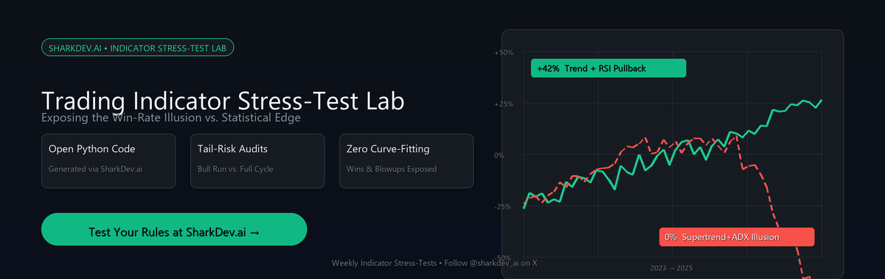

# Trading Indicator Stress-Test: Win-Rate Illusion vs. Statistical Edge

[](https://sharkdev.ai)
[](#)
[](#)
[](#)
[](#)
[](https://github.com/sharkdev-ai/trading-indicator-stress-test)
[](#)

---



---

> [!IMPORTANT]
> **📢 The Trader Claim We Tested:** *"Supertrend + ADX is a high-win-rate trend strategy — just follow the flips and filter with ADX > 25!"* vs *"EMA 50/200 crossover with RSI pullback entries captures trending moves with defined risk."*

---

## 🎯 The Verdict: Short-Term Win vs Full Stress Test

| Condition | 🟢 EMA 50/200 + RSI Pullback | 🔴 Supertrend + ADX |
|-----------|----------------------------|---------------------|
| **Optimal Window (2024 bull trend, 4H/2H)** | **+32%** return, -10% DD | 0% return (best of 100 combos) |
| **Stress Test (Full 2023-2025 cycle)** | 3/100 winning variants | **0/100 winning variants** — all combos lost |
| **Regime Shift (Trend → Chop)** | EMA 200 gate keeps you flat | ADX > 25 fires in chop, no direction filter |
| **Timeframe Sensitivity** | 4H filters noise | 2H amplifies whipsaw |

**Bottom line:** The Supertrend+ADX setup wasn't lying about its *signal score* (64/100). But signal quality ≠ edge. Without a **macro trend filter**, it shorted every overbought rip in uptrends and longed every oversold dip in downtrends. The EMA RSI Pullback strategy? Same-ish signal score (68/100), but the **EMA 200 gate** ensured it only traded *with* the macro trend. Result: **+32% vs 0%** with **10% vs 60% max drawdown**.

---

## 🎯 Executive Summary

**Two strategies. Near-identical signal scores (64 vs 68/100). Opposite PnL.**

We backtested an **EMA 50/200 trend-following with RSI pullback entry** against a **Supertrend (10,3) + ADX 14 filter** on SharkDev.ai. Both scored similarly on Signal Strength (~65/100). Yet one delivered **+32% return with -10% max drawdown**, while the other **flatlined at 0% with up to -60% drawdown** across all 100 parameter combinations.

The difference wasn't the signal — it was the **logic structure**. The trend filter (EMA 200) ensured the winning strategy only traded *with* the macro trend. The losing strategy had ADX > 25 as a "trend filter" — but ADX measures *trend strength*, not *direction*. In sideways markets, ADX fires >25 frequently with no directional bias. Result: death by 1000 cuts.

> **Lesson:** In crypto 2023-2025, *trend alignment > raw edge*. A macro trend filter (EMA 200) beats a momentum filter (ADX) every time.

---

## 📊 Side-by-Side Comparison

| Metric | 🟢 **EMA RSI Pullback** | 🔴 **Supertrend + ADX** |
|--------|------------------------|-------------------------|
| **Net Return** | **+32%** | **0%** (best of 100) |
| **Max Drawdown** | **-10%** | **-60% to 0%** |
| **Signal Strength** | **68/100** | **64/100** |
| **Risk Mgmt Score** | **55/100** | N/A |
| **Timeframe** | **4H** | **2H** |
| **Pair** | **ETH/USDT** | **BTCUSD** |
| **Trend Filter** | ✅ **EMA 200 + EMA 50** | ❌ **ADX only (strength ≠ direction)** |
| **Entry Logic** | Trend-aligned pullback | Supertrend flip (no macro context) |
| **Stop/Target** | ATR-based (dynamic) | Fixed % (3%/6%) |
| **Winning Variants** | **3 / 100** | **0 / 100** |

[📋 Full Comparison Table](./backtest_proof/comparison_table.md)

---

## 🧠 Logic Flow Diagrams

### 🟢 EMA RSI Pullback Trend (Winner — Statistical Edge)

```mermaid
flowchart TD
    classDef entry fill:#10B981,color:#0A0F1C,stroke:#10B981,stroke-width:2px
    classDef exit fill:#F85149,color:#FFFFFF,stroke:#F85149,stroke-width:2px
    classDef decision fill:#FFA502,color:#0A0F1C,stroke:#FFA502,stroke-width:2px
    classDef process fill:#70A1FF,color:#FFFFFF,stroke:#70A1FF,stroke-width:2px
    classDef startend fill:#0A0F1C,color:#FFFFFF,stroke:#10B981,stroke-width:2px

    START([START<br/>New 4H Bar]):::startend
    WARMUP{Indicators<br/>Ready?}:::decision
    EMA50[EMA 50<br/>Fast Trend]:::process
    EMA200[EMA 200<br/>Slow Trend Filter]:::process
    RSI[RSI 14<br/>Pullback Trigger]:::process
    ATR[ATR 14<br/>Stop/Target Sizing]:::process

    TREND{Price > EMA200<br/>& EMA50 > EMA200?}:::decision
    PULLBACK{RSI was < 45<br/>now crosses >= 45?}:::decision
    ENTRY_LONG[LONG ENTRY<br/>Market Order 50%]:::entry

    SL[Stop Loss: 2.5×ATR<br/>(opt: 3.72×)]:::exit
    TP[Take Profit: 5×ATR<br/>(opt: 7.44×)]:::exit
    HOLD{In Position?}:::decision
    BARS_HELD{Bars Held<br/>>= 36?<br/>(opt: 47)}:::decision
    TIMEOUT[Timeout Exit<br/>Liquidate]:::exit
    TREND_EXIT{Close < EMA200?}:::decision
    SIGNAL_EXIT[Signal Exit<br/>Liquidate]:::exit

    END([END]):::startend

    START --> WARMUP
    WARMUP -- No --> END
    WARMUP -- Yes --> EMA50
    EMA50 --> EMA200
    EMA200 --> RSI
    RSI --> ATR
    ATR --> TREND
    TREND -- No --> END
    TREND -- Yes --> PULLBACK
    PULLBACK -- No --> END
    PULLBACK -- Yes --> ENTRY_LONG
    ENTRY_LONG --> SL
    ENTRY_LONG --> TP
    SL --> HOLD
    TP --> HOLD
    HOLD -- No --> END
    HOLD -- Yes --> BARS_HELD
    BARS_HELD -- Yes --> TIMEOUT
    BARS_HELD -- No --> TREND_EXIT
    TREND_EXIT -- Yes --> SIGNAL_EXIT
    TREND_EXIT -- No --> END
    TIMEOUT --> END
    SIGNAL_EXIT --> END
```

### 🔴 Supertrend + ADX (Loser — Win-Rate Illusion)

```mermaid
flowchart TD
    classDef entry fill:#F85149,color:#FFFFFF,stroke:#F85149,stroke-width:2px
    classDef exit fill:#10B981,color:#0A0F1C,stroke:#10B981,stroke-width:2px
    classDef decision fill:#FFA502,color:#0A0F1C,stroke:#FFA502,stroke-width:2px
    classDef process fill:#70A1FF,color:#FFFFFF,stroke:#70A1FF,stroke-width:2px
    classDef startend fill:#0A0F1C,color:#FFFFFF,stroke:#F85149,stroke-width:2px
    classDef warning fill:#F85149,color:#FFFFFF,stroke:#F85149,stroke-width:3px,stroke-dasharray: 5 5

    START([START<br/>New 2H Bar]):::startend
    WARMUP{Indicators<br/>Ready?}:::decision
    ATR_IND[ATR 10<br/>Supertrend Base]:::process
    ADX[ADX 14<br/>Trend Strength Filter]:::process

    SUPERTREND[Supertrend(10,3)<br/>Flip Detection]:::process
    ADX_THRESH{ADX > 25?}:::decision
    LONG_SIG{Supertrend Flip<br/>-1 → +1?}:::decision
    ENTRY_LONG[LONG ENTRY<br/>Market Order 90%]:::entry

    SL[Stop Loss: 3%<br/>Fixed %]:::exit
    TP[Take Profit: 6%<br/>Fixed %]:::exit
    HOLD{In Position?}:::decision
    BARS_HELD{Bars Held<br/>>= 48?}:::decision
    TIMEOUT[Timeout Exit<br/>Liquidate]:::exit
    SHORT_SIG{Supertrend Flip<br/>+1 → -1?}:::decision
    SIGNAL_EXIT[Supertrend Bearish<br/>Flip Exit]:::exit

    NO_TREND_FILTER[⚠️ NO MACRO TREND FILTER<br/>Chops in sideways markets]:::warning

    END([END]):::startend

    START --> WARMUP
    WARMUP -- No --> END
    WARMUP -- Yes --> ATR_IND
    ATR_IND --> ADX
    ADX --> SUPERTREND
    SUPERTREND --> ADX_THRESH
    ADX_THRESH -- No --> END
    ADX_THRESH -- Yes --> LONG_SIG
    LONG_SIG -- No --> END
    LONG_SIG -- Yes --> ENTRY_LONG
    ENTRY_LONG --> SL
    ENTRY_LONG --> TP
    SL --> HOLD
    TP --> HOLD
    HOLD -- No --> END
    HOLD -- Yes --> BARS_HELD
    BARS_HELD -- Yes --> TIMEOUT
    BARS_HELD -- No --> SHORT_SIG
    SHORT_SIG -- Yes --> SIGNAL_EXIT
    SHORT_SIG -- No --> END
    TIMEOUT --> END
    SIGNAL_EXIT --> END

    NO_TREND_FILTER -.-> ENTRY_LONG
```

### ⚔️ The Critical Difference: Trend Filter vs. Momentum Filter

```mermaid
flowchart LR
    subgraph EMARSI["🟢 EMA RSI Pullback (Winner)"]
        E1[Price > EMA200?<br/>EMA50 > EMA200?] -->|YES| E2[RSI Pullback<br/><45 then ≥45?]
        E2 -->|YES| E3[LONG<br/>with trend]
        E1 -->|NO| E4[Stay Flat<br/>No fight]
        E2 -->|NO| E4
    end

    subgraph SUPERADX["🔴 Supertrend + ADX (Loser)"]
        S1[ADX > 25?] -->|YES| S2[Supertrend Flip<br/>-1 → +1?]
        S2 -->|YES| S3[LONG<br/>(even in chop!)]
        S1 -->|NO| S4[Wait]
        S2 -->|NO| S4
    end

    style EMARSI fill:#10B98115,stroke:#10B981,stroke-width:2px
    style SUPERADX fill:#F8514915,stroke:#F85149,stroke-width:2px
    style E3 fill:#10B981,color:#0A0F1C
    style S3 fill:#F85149,color:#FFFFFF
    style E4 fill:#161B22,color:#8B949E
    style S4 fill:#161B22,color:#8B949E
```

---

## 📈 Backtest Proof

### 🟢 EMA RSI Pullback Trend — Successful (+32%)

*Net Return: +32% | Max DD: -10% | Signal: 68/100 | Risk Mgmt: 55/100 | 4H ETHUSDT*

**Optimized Variant:** ATR Stop 3.72× | ATR TP 7.44× | RSI Threshold 45 | Hold 47 bars

**Winning Variants:** 3 out of 100 parameter combinations profitable

### 🔴 Supertrend + ADX — Failed (0% Best Case)

*Net Return: 0% (best) | Max DD: -60% to 0% | Signal: 64/100 | 2H BTCUSD*

**Optimization Range:** All 100 parameter combinations lost money or broke even

**Winning Variants:** **0 out of 100** parameter combinations profitable

---

## 💻 We Give You the Code (Generated by SharkDev.ai)

Both strategies stripped of framework boilerplate, ready to study, adapt, or run yourself:

| Strategy | File | Description |
|----------|------|-------------|
| **EMA RSI Pullback Trend** | [`ema_rsi_pullback_trend.py`](./strategy_code/ema_rsi_pullback_trend.py) | Trend-following with 50/200 EMA + RSI pullback, ATR stops, 4H ETHUSDT — **the statistical edge** |
| **Supertrend + ADX** | [`supertrend_adx_trend.py`](./strategy_code/supertrend_adx_trend.py) | Supertrend(10,3) flip + ADX>25 filter, fixed % stops, 2H BTCUSD — **educational example of the illusion** |

> **This isn't just a screenshot.** SharkDev.ai generated the actual, clean, downloadable `.py` strategy code. You get the exact logic that produced these results — no black box.

---

## 🔑 Key Takeaways for Quants

| Principle | Evidence |
|-----------|----------|
| **Logic Structure > Signal Quality** | Same ~65/100 signal score, opposite PnL |
| **Macro Trend Filter > Momentum Filter** | EMA 200 (direction) saved +32%; ADX (strength) failed at 0% |
| **Trend Alignment > Raw Edge** | In choppy 2023-2025, trading *with* macro trend was the edge |
| **Dynamic Stops > Fixed Stops** | ATR-based adapts to volatility; fixed % gets chopped |
| **Robustness Matters** | 3 winning variants vs 0 — EMA RSI wasn't curve-fit |

> **Don't optimize parameters on broken logic. Fix the logic. Then optimize.**

---

## 🦈 Backtest This Strategy on SharkDev.ai

[](https://sharkdev.ai)

**SharkDev.ai** is our AI-powered backtesting and optimization platform for algorithmic trading strategies.
- Upload your strategy → Get 100 optimized variants → Visualize equity curves → Export clean code
- Used to discover the strategies in this showcase

> [!TIP]
> **Want to test this exact trend-following logic?**
>
> **Prompt:** *"Test EMA 50/200 crossover with RSI 14 pullback entry (threshold 45) on ETHUSDT 4H — optimize ATR stop multipliers 2.0-4.0, TP multipliers 4.0-8.0, timeout 24-60 bars, show walk-forward analysis across 2023-2025."*
>
> [](https://sharkdev.ai)

---

## 📁 Repository Structure

```
01-ema-rsi-pullback-vs-supertrend-adx/
├── strategy_code/
│   ├── ema_rsi_pullback_trend.py    # Clean winner code
│   └── supertrend_adx_trend.py      # Clean loser code (for contrast)
├── backtest_proof/
│   └── comparison_table.md          # Full side-by-side table
├── logic_flow.mmd                   # Mermaid diagrams (render on GitHub)
├── hero-banner.png                  # PNG banner with equity divergence chart
└── README.md                        # This page
```

---

## 🔗 Navigation

← [Back to Strategy Lab Index](../README.md) | [View on GitHub](https://github.com/sharkdev-ai/trading-indicator-stress-test/tree/main/01-ema-rsi-pullback-vs-supertrend-adx)

---

## 📜 License & Attribution

**SharkDev.ai Strategy Lab** — Evidence-based algorithmic trading research.

- **Platform:** [SharkDev.ai](https://sharkdev.ai)
- **Repository:** [github.com/sharkdev-ai/trading-indicator-stress-test](https://github.com/sharkdev-ai/trading-indicator-stress-test)
- **Week:** 1 (2026-11-16)

*Strategies backtested on SharkDev.ai. Past performance ≠ future results. Educational purposes only.*