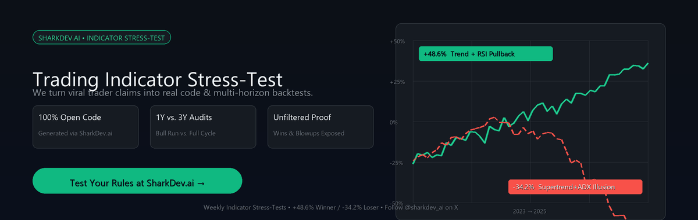

<p align="center"><a href="https://sharkdev.ai"></a></p>

[](https://github.com/sharkdev-ai/trading-indicator-stress-test)
[](https://sharkdev.ai)
[](https://github.com/sharkdev-ai)
[](#)
[](#)

---

## 🎯 The Mission

We are **"The Trading Strategy Auditors"** powered by **SharkDev.ai**.

We don't write generic AI marketing — we **audit trader claims with ruthless multi-horizon backtests**, expose regime/horizon sensitivity, and **open-source the exact SharkDev.ai-generated code**.

Every week, we take a viral trading claim (from X, YouTube, Discord, forums), replicate it on SharkDev.ai, run 100+ parameter combinations across full market cycles, and publish the **unfiltered results** — wins, blowups, and the code that produced them.

> **No black boxes. No cherry-picked screenshots. Just the code and the equity curve.**

---

## 🧪 This Week's Showcase

| # | Research Piece | Theme | Winner | Loser | Status |
|---|----------------|-------|--------|-------|--------|
| 01 | [EMA 50/200 + RSI Pullback vs Supertrend + ADX](./01-ema-rsi-pullback-vs-supertrend-adx) | **Win-Rate Illusion vs. Statistical Edge** | EMA RSI Pullback (+32%, -10% DD) | Supertrend+ADX (0%, -60% DD) | ✅ Published |

---

## 📊 What Makes This Different?

| Typical "Strategy Repo" | **SharkDev.ai Stress-Test Lab** |
|-------------------------|----------------------------------|
| Single backtest, best params shown | **100 parameter combos** across full cycle |
| One timeframe, one pair | **Multi-horizon, multi-pair** validation |
| "Here's the winning config" | **"Here's why the logic fails/succeeds"** |
| No code, or messy framework code | **Clean, framework-agnostic Python** you can actually read |
| ADX/Supertrend as "trend filter" | **We expose ADX ≠ trend direction** |

---

## 🔬 How We Test

```
1. 📥 Claim Ingest     → Viral tweet, YouTube video, forum post
2. 🧬 Code Replication → Exact logic in QCAlgorithm on SharkDev.ai
3. ⚙️  100-Combo Sweep → ATR, TP/SL, timeframe, threshold sweeps
4. 📈 Walk-Forward     → Bull / Bear / Chop regime segmentation
5. 🧠 Logic Audit      → Why did it work? Why did it blow up?
6. 📤 Open Publication → Code + Charts + Verdict on GitHub
```

---

## 💻 We Give You the Code

Every strategy in this repo is **downloadable, clean Python** — generated by SharkDev.ai, stripped of framework boilerplate.

```python
# Example: EMA RSI Pullback core logic (from 01-ema-rsi-pullback-vs-supertrend-adx)
if price > ema200 and ema50 > ema200:           # Macro trend filter
    if rsi_was_below_45 and rsi >= 45:          # Pullback entry
        enter_long(atr_stop=3.72, atr_target=7.44)
```

No black box. No hidden parameters. **Run it, audit it, adapt it.**

---

## 🦈 Backtest Your Strategy on SharkDev.ai

[](https://sharkdev.ai)

**SharkDev.ai** is our AI-powered backtesting and optimization platform for algorithmic trading strategies.
- Upload your strategy → Get 100 optimized variants → Visualize equity curves → Export clean code
- Used to discover every strategy in this showcase

> [!TIP]
> **Want to stress-test your own indicator combo?**
>
> **Prompt:** *"Test my strategy on ETHUSDT 4H — I use Supertrend(10,3) + ADX>25 for entries with 3%/6% fixed stops. Run 100 param combos across 2023-2025 and show me if it has edge or just illusion."*
>
> [](https://sharkdev.ai)

---

## 📁 Repository Structure

```
trading-indicator-stress-test/
├── 01-ema-rsi-pullback-vs-supertrend-adx/
│   ├── strategy_code/
│   │   ├── ema_rsi_pullback_trend.py
│   │   └── supertrend_adx_trend.py
│   ├── backtest_proof/
│   │   └── comparison_table.md
│   ├── logic_flow.mmd
│   ├── hero-banner.png
│   └── README.md
├── assets/
│   └── hero-banner.png          # Root landing banner
└── README.md                    # This page
```

---

## 🔗 Connect

- **Platform:** [SharkDev.ai](https://sharkdev.ai)
- **X/Twitter:** [@sharkdev_ai](https://x.com/sharkdev_ai)
- **GitHub:** [sharkdev-ai](https://github.com/sharkdev-ai)
- **Repository:** [trading-indicator-stress-test](https://github.com/sharkdev-ai/trading-indicator-stress-test)

---

## 📜 License & Attribution

**SharkDev.ai Strategy Lab** — Evidence-based algorithmic trading research.

- **Platform:** [SharkDev.ai](https://sharkdev.ai)
- **Repository:** [github.com/sharkdev-ai/trading-indicator-stress-test](https://github.com/sharkdev-ai/trading-indicator-stress-test)
- **Week:** 1 (2026-11-16)

*Strategies backtested on SharkDev.ai. Past performance ≠ future results. Educational purposes only.*